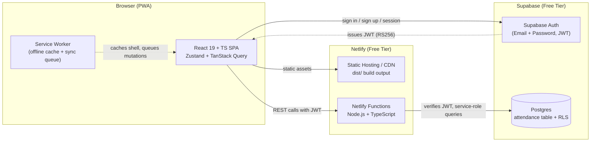

# Architecture — Clock In / Clock Out

## 1. Goals that shaped every decision

- **$0 to run** for a single user, indefinitely, on free tiers.
- **Multi-user-ready from day one**, even though only one person uses it today — retrofitting `user_id` + Row Level Security later is far riskier than doing it now.
- **Correct time handling** — clock events happen across timezones/DST, so the system of record must be unambiguous (UTC) while the UI stays local.
- **Low operational surface** — no servers to patch, no containers to babysit. Everything is either a static file, a short-lived function, or a managed Postgres instance.

## 2. System overview



**Why this shape and not "React talks directly to Supabase"?**
Supabase's client SDK could call Postgres (via PostgREST) directly from the browser under RLS, which would be simpler and also free. We still put Netlify Functions in front for three reasons:

1. **A single, versioned REST contract** (`/clock-in`, `/attendance/report`, …) that matches the spec exactly, instead of leaking PostgREST's query-string dialect to the frontend.
2. **Server-side business rules that RLS can't express cleanly** — "no clock-in while already clocked in", duration calculation, report aggregation — belong in code, not in trigger soup. RLS still acts as the last line of defense (see §5).
3. **A safe place to hold the service-role key** and to add rate limiting, without ever shipping that key to the browser.

The tradeoff is accepted: Netlify Functions cold starts add ~100–300ms on the free tier. For a personal attendance tool this is invisible in practice.

## 3. Why this stack, decision by decision

| Choice                             | Why                                                                                                                                                                                                                                                            | Rejected alternative                                                                                                                                                                         |
| ---------------------------------- | -------------------------------------------------------------------------------------------------------------------------------------------------------------------------------------------------------------------------------------------------------------- | -------------------------------------------------------------------------------------------------------------------------------------------------------------------------------------------- |
| **React 19 + Vite**                | Fastest dev/build loop, first-class TS support, tiny static output that Netlify serves for free.                                                                                                                                                               | Next.js — its serverless SSR model adds complexity (and cold-start cost) this app doesn't need; we have no SEO requirement and every page is behind auth.                                    |
| **TypeScript everywhere (strict)** | Attendance math (UTC ↔ local, minute rounding, month boundaries) is exactly the kind of code that silently rots without types.                                                                                                                                 | Plain JS — too easy to pass a `Date` where an ISO string was expected.                                                                                                                       |
| **Tailwind + shadcn/ui**           | shadcn's components are copied into the repo, not installed as an opaque dependency — full control over the glassmorphism look, no vendor lock-in, no extra runtime cost.                                                                                      | MUI/Chakra — heavier runtime, harder to restyle for a custom glass aesthetic.                                                                                                                |
| **TanStack Query**                 | Server state (attendance records, reports) has its own lifecycle — caching, retries, background refetch, optimistic updates for Clock In/Out — that's exactly what it's built for.                                                                             | Rolling this by hand in `useEffect` — reinvents caching/retry badly.                                                                                                                         |
| **Zustand**                        | Only genuinely global _client_ state is auth/session + UI prefs (theme, sidebar). Zustand is a few lines of code and persists to `localStorage` trivially.                                                                                                     | Redux Toolkit — far more ceremony than a 2-slice app needs.                                                                                                                                  |
| **React Hook Form + Zod**          | One schema (Zod) defines validation, doubles as the TypeScript type via `z.infer`, and drives both client-side (RHF) and server-side (Netlify Function) validation — one source of truth.                                                                      | Formik — no built-in schema-to-type inference story as clean as Zod.                                                                                                                         |
| **date-fns / date-fns-tz**         | Tree-shakeable, immutable, and explicit about timezone conversion — critical since the spec requires UTC storage + local display.                                                                                                                              | `moment.js` — deprecated, mutable, much larger bundle.                                                                                                                                       |
| **Netlify Functions (Node + TS)**  | Free tier: 125k invocations/month, 100 hours runtime/month — orders of magnitude more than one person clocking in/out twice a day needs. Deploys with the frontend from the same repo/CI.                                                                      | AWS Lambda directly — extra account, extra IaC, no benefit at this scale. Supabase Edge Functions — would split "backend" across two providers for no gain since Supabase is already the DB. |
| **Supabase (Auth + Postgres)**     | Free tier gives a real Postgres database (not a toy), built-in RLS, and email/password auth with JWTs Netlify Functions can verify statelessly. 500MB DB and 50k MAU is vastly more than one year of one user's attendance rows (~365 rows/year ≈ tens of KB). | Firebase — NoSQL is a poor fit for relational reporting queries (weekly/monthly aggregates); Auth0 — no database included, would need a second free-tier vendor.                             |

## 4. Clean/layered architecture

The codebase is organized so that business rules don't depend on frameworks, and frameworks don't leak into business rules:

```
Presentation   → pages/, components/, layouts/         (React, shadcn/ui, Framer Motion)
Application    → features/*/hooks, features/*/api      (TanStack Query hooks, Zustand stores)
Domain         → types/, utils/ (attendance math, zod schemas)   (pure functions, no I/O)
Infrastructure → services/, api/, netlify/functions/, supabase/  (Supabase client, HTTP, DB)
```

- **Domain logic is pure and framework-agnostic.** e.g. `computeWorkedMinutes(clockIn, clockOut)`, `isSameLocalDay(date, tz)` live in `utils/` with no import of React or Supabase, and are unit-testable in isolation with Vitest.
- **Netlify Functions and the React app share the domain layer** (`src/types`, `src/utils`, Zod schemas) via a shared package path, so "clock-out before clock-in" is validated identically on client and server without duplicating the rule.
- **Dependency direction is inward-only**: presentation depends on application depends on domain; domain depends on nothing. Infrastructure implements interfaces the domain defines (e.g. an `AttendanceRepository` interface backed by a Supabase implementation), so the DB could be swapped later without touching business rules.

This directly satisfies SOLID (each layer has one reason to change), DRY (validation rules and time math defined once), and KISS (no abstraction — like a repository interface — is introduced until Phase 2 actually needs it for testability).

## 5. Security model (defense in depth)

1. **Supabase Auth** issues a short-lived JWT (RS256) on email/password sign-in.
2. **Every Netlify Function** verifies that JWT (via Supabase's JWKS / `supabase.auth.getUser(jwt)`) before doing anything — no function trusts a `user_id` sent in the request body.
3. **Row Level Security** on the `attendance` table means that even if a function or a future client had a bug, Postgres itself refuses to return or mutate another user's rows. RLS is the backstop, not the primary gate.
4. **Service-role key** (which bypasses RLS) lives only in Netlify's encrypted environment variables and is only used server-side, after the JWT check — never sent to or readable by the browser.
5. **Rate limiting** on mutating endpoints (`/clock-in`, `/clock-out`) is implemented in-function using a small fixed-window counter keyed by `user_id`, backed by a `rate_limits` table in the same free Postgres instance (no paid Redis needed).
6. **Input validation** happens twice: Zod on the client (fast feedback) and the identical Zod schema again inside the function (never trust the network).

## 6. Timezone handling

- The client captures the IANA timezone (`Intl.DateTimeFormat().resolvedOptions().timeZone`) at the moment of Clock In and sends it with the request.
- The server stores `clock_in` / `clock_out` as `timestamptz` (UTC internally, Postgres' native behavior) plus the captured `timezone` string.
- All display formatting (today's card, tables, reports) converts UTC → the record's stored timezone (or the browser's current timezone for "today") using `date-fns-tz`, so a user traveling across timezones still sees each day's hours the way they experienced them.
- "One Clock In per day" is evaluated against the **local calendar date in the captured timezone**, not the UTC date, to avoid an 11pm clock-in in one timezone spilling into "tomorrow" in UTC.

## 7. Offline / PWA strategy

- `vite-plugin-pwa` generates the service worker and manifest — the app is installable (icons in `public/icons/`).
- The app shell (JS/CSS/fonts/icons) is precached, so the UI opens instantly and works offline.
- `/api/*` is **NetworkOnly** — attendance data is per-user and is never written to the service-worker cache, so nothing stale or private is left behind on a shared device.
- **Clock In/Out is disabled while offline rather than queued** (revised from the original plan). The server stamps `clock_in`/`clock_out` with its own clock and never trusts a client timestamp; a request replayed later would therefore record the wrong time. Supporting true offline punches would require accepting a client-supplied timestamp with a bounded skew check — a deliberate future decision, not a silent default.

## 8. Sessions, breaks, corrections, auto-close and leave (Option 2)

Designed in [06-option2-plan.md](06-option2-plan.md); summary of how it fits the architecture above:

- **Data** — `attendance` is a per-day summary; punches live in `attendance_sessions` / `attendance_breaks`; every change is written to the append-only `attendance_audit` with before/after day snapshots and the user's reason.
- **Business rules moved into the database** for writes. Each action (clock in/out, break start/end, correction, leave, auto-close) is one Postgres function that changes the rows, recomputes the day's totals and writes the audit entry in a single transaction. Exclusion constraints make overlapping sessions impossible even under concurrency. Netlify Functions still own auth, rate limiting and input validation, then call the function with the verified `user_id`.
- **Least privilege** — those functions are executable only by `service_role`; browser roles can read their own rows (RLS) but can't write or call them, so the audit trail can't be bypassed.
- **Auto-close** is a Netlify scheduled function (every 30 min) calling `att_auto_close()`.
- **One source of rules, mirrored for UX** — `src/lib/shared/aggregate/day.ts` repeats the totals/correction rules in TypeScript so the editor can show live totals and errors; the database remains authoritative and tests pin both to the same cases.

## 9. What Phase 1 deliberately defers

- Concrete component trees and hook implementations → Phase 3.
- Exact Netlify Function handler code → Phase 2.
- CI/CD (GitHub Actions → Netlify) wiring details → Phase 8 (done: `.github/workflows/ci.yml`, `docs/deployment-guide.md`).

These are called out here so review can confirm direction before any code is written.
