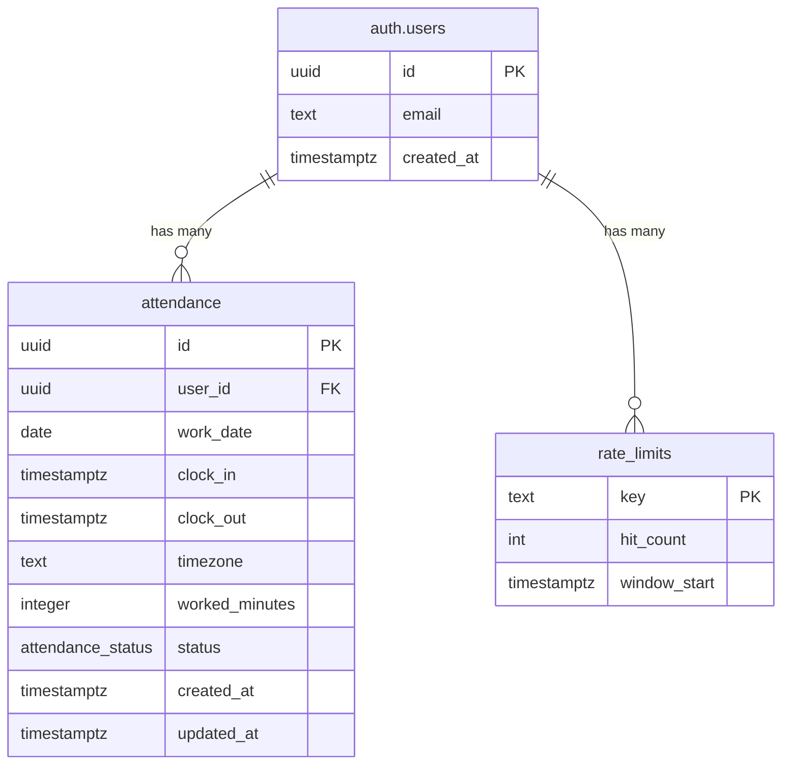

# Database Schema

## 1. Entity-relationship diagram



`attendance` is the only domain table the spec requires. `rate_limits` is small infrastructure support for the rate-limiting requirement (§Security) — it's in the same free Postgres instance rather than a paid Redis add-on.

## 2. Why this design

- **One row per (user, calendar day)**, enforced by a `UNIQUE (user_id, work_date)` constraint — this _is_ the "one Clock In per day" business rule, enforced at the data layer, not just in application code. A second Clock In attempt on the same day fails at the database with a `23505` unique-violation, which the Netlify Function translates into a clean `409 Conflict`.
- **`work_date` is a plain `date`, computed from the local timezone at clock-in time**, not derived from `clock_in::date` (which would silently use UTC and misclassify late-evening clock-ins in negative-UTC-offset timezones). It's written explicitly by the `/clock-in` function.
- **`clock_in`/`clock_out` are `timestamptz`** — Postgres always stores these as UTC internally and converts on the way out, which matches "store UTC, display local" directly; the app doesn't need to do manual UTC math for storage, only for _display_.
- **`worked_minutes` is persisted, not computed on every read.** It's written once at Clock Out (`extract(epoch from (clock_out - clock_in)) / 60`, rounded). This keeps monthly/report aggregation to a plain `SUM()` instead of recomputing interval arithmetic across potentially thousands of rows on every dashboard load.
- **`status` is a Postgres enum** (`working` | `completed`) rather than free text, so invalid states can't be inserted, and queries like "find today's open session" are a simple, indexable equality filter.
- **`user_id references auth.users(id)`** — Supabase's built-in auth schema — rather than a custom `profiles` table, because the spec needs no additional profile fields yet. If profile data (display name, avatar) is needed later, a `profiles` table can be added without touching `attendance`.
- **No soft-delete column.** Attendance history is an append/update log a user corrects, not something rows get "deleted" from in normal use; if deletion is ever needed it's a rare admin action, not a hot path worth a `deleted_at` filter on every query.

## 3. Table: `attendance`

| Column           | Type                       | Constraints                                                                     | Notes                                               |
| ---------------- | -------------------------- | ------------------------------------------------------------------------------- | --------------------------------------------------- |
| `id`             | `uuid`                     | `PK`, `default gen_random_uuid()`                                               | Surrogate key                                       |
| `user_id`        | `uuid`                     | `NOT NULL`, `FK → auth.users(id) ON DELETE CASCADE`                             | Owner of the record                                 |
| `work_date`      | `date`                     | `NOT NULL`                                                                      | Local calendar date the session belongs to          |
| `clock_in`       | `timestamptz`              | `NOT NULL`                                                                      | UTC instant of clock-in                             |
| `clock_out`      | `timestamptz`              | `NULL` until completed                                                          | UTC instant of clock-out                            |
| `timezone`       | `text`                     | `NOT NULL`                                                                      | IANA zone captured client-side, e.g. `Asia/Kolkata` |
| `worked_minutes` | `integer`                  | `NULL` until completed, `CHECK (worked_minutes IS NULL OR worked_minutes >= 0)` | Persisted duration                                  |
| `status`         | `attendance_status` (enum) | `NOT NULL DEFAULT 'working'`                                                    | `working` \| `completed`                            |
| `created_at`     | `timestamptz`              | `NOT NULL DEFAULT now()`                                                        | Row creation                                        |
| `updated_at`     | `timestamptz`              | `NOT NULL DEFAULT now()`                                                        | Auto-touched by trigger on every update             |

**Constraints**

- `UNIQUE (user_id, work_date)` — one attendance record per user per day.
- `CHECK (clock_out IS NULL OR clock_out > clock_in)` — cannot clock out before/at clock-in, enforced by the database, not just the API.
- `CHECK ((status = 'working' AND clock_out IS NULL AND worked_minutes IS NULL) OR (status = 'completed' AND clock_out IS NOT NULL AND worked_minutes IS NOT NULL))` — status and the presence of clock-out/duration can never disagree.

**Indexes**

- `attendance_user_date_idx` — `UNIQUE (user_id, work_date)` (doubles as the business-rule constraint and the primary lookup index for "today" and month-range queries).
- `attendance_user_status_idx` — `(user_id, status)` partial-friendly index for "find my current open session" (`status = 'working'`) in O(log n).
- `attendance_user_created_idx` — `(user_id, created_at DESC)` for the paginated History view's default sort.

## 4. Row Level Security

RLS is enabled on `attendance` with four policies (select/insert/update/delete), each scoped to `auth.uid() = user_id`. This means:

- Even though Netlify Functions use the **service-role key** (which bypasses RLS) to perform the actual queries after verifying the JWT themselves, RLS still protects the table if it's ever queried directly from the browser with the anon key + user JWT (e.g. a future client-side read for optimistic UI), or if a function bug ever forwarded the wrong `user_id`.
- This is the "defense in depth" from the architecture doc, not the only line of defense — the Netlify Function's own JWT-derived `user_id` is what's actually used in `INSERT`/`UPDATE` statements; RLS is the backstop that makes a mistake in that logic non-catastrophic.

## 5. `rate_limits` table

A minimal fixed-window counter: `key` (e.g. `"clock-in:{user_id}"`), `hit_count`, `window_start`. The Netlify Function increments/reads this instead of needing Upstash/Redis (which would break the "$0" constraint). RLS is **not** relevant here since only the service role touches this table — it's never queried with a user JWT.

## 6. Refinement found during Phase 2 implementation: one open session per user, not per day

The per-day unique constraint in `0001_init.sql` enforces "one row per day" but does **not**, by itself, stop a second Clock In if a session from a _previous_ day was never clocked out (e.g. a night shift, or the user simply forgot) — `work_date` would differ, so the unique constraint wouldn't fire. The spec's rule is "do not allow Clock In twice without Clock Out," which is a global condition, not a per-day one.

`0002_attendance_refinements.sql` closes this with a **partial unique index**:

```sql
create unique index attendance_one_open_session_per_user
  on public.attendance (user_id)
  where (status = 'working');
```

This guarantees at most one `working` row per user at the database level — including under concurrent requests, where a check-then-insert in application code alone would leave a race window.

The same migration adds `check_rate_limit(key, limit, window_seconds)`, a single-statement atomic UPSERT used by the Netlify Functions for the fixed-window rate limiter (see [API design](04-api-design.md)), so concurrent requests for the same key can't race each other into both succeeding.

## 7. Migrations

- [`supabase/migrations/0001_init.sql`](../supabase/migrations/0001_init.sql) — enum, table, constraints, indexes, RLS policies, `updated_at` trigger, `rate_limits` table.
- [`supabase/migrations/0002_attendance_refinements.sql`](../supabase/migrations/0002_attendance_refinements.sql) — single-open-session index, `check_rate_limit` RPC.

## 7. Migration 0003 — sessions, breaks, audit (Option 2 / Phase 1)

See [06-option2-plan.md](06-option2-plan.md) for the full design. In short:

- `attendance` is now the **per-day summary**. `status` is `text` with `CHECK (status in ('working','on_break','completed','leave'))`; `clock_in`/`clock_out` mean _first in_ / _last out_; new columns `break_minutes`, `leave_reason`, `auto_closed`, `needs_review`. `clock_in` is nullable (leave days).
- `attendance_sessions` and `attendance_breaks` hold the punches. One open session and one open break per user (partial unique indexes); a user's sessions — and breaks — can never overlap (`EXCLUDE USING gist`, needs `btree_gist`). Composite FKs `(parent_id, user_id)` guarantee children belong to the same user as their day.
- `attendance_audit` is append-only: action, actor, reason and full before/after day snapshots (`jsonb`).
- All writes go through `att_*` functions executable **only by `service_role`**; browser roles keep read-only, RLS-scoped access. `check_rate_limit` is locked down the same way.
- Existing rows are backfilled into one session each; totals don't change.

Tests: `npm run test:db` applies every migration to an in-process Postgres (PGlite) with a stub of Supabase's `auth` schema and roles, then exercises the functions, constraints, RLS and grants (`tests/db/`).
